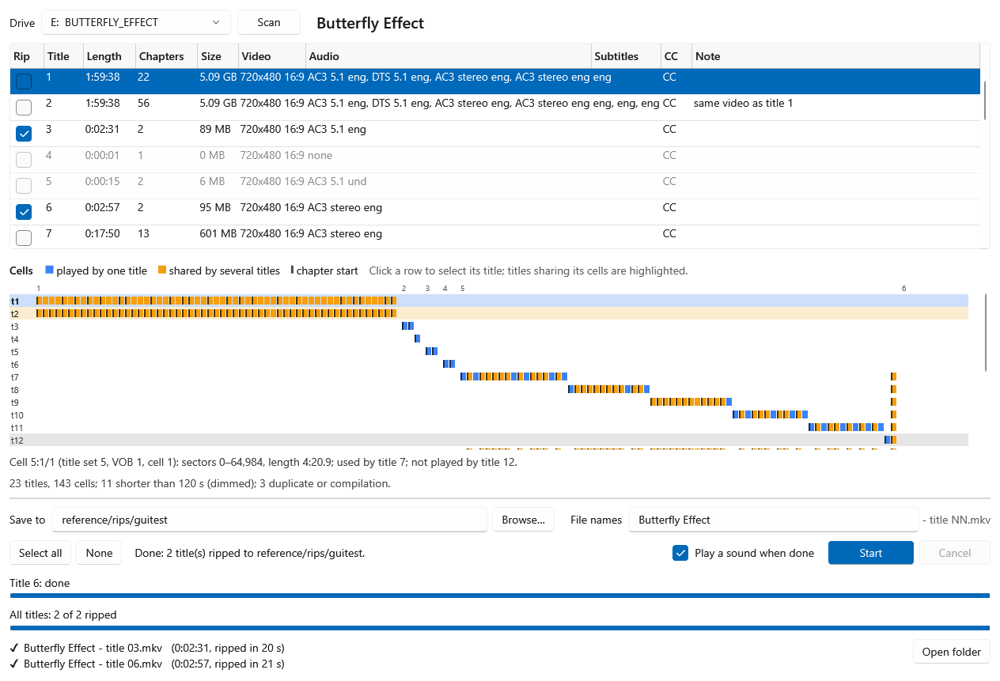

# rip-dvd

Rips movies and TV episodes from a DVD into MKV files, much like [MakeMKV](https://www.makemkv.com/) does for DVDs.
Everything is C# on .NET 10, with no external tools or native libraries needed at run time.

- **Command line** (`rip-dvd`): lists a disc's titles and rips the ones you name.
- **Windows app** (`rip-dvd-gui`): scans the disc when it is inserted, shows the titles and which parts of the disc they share,
	and rips the titles you check, with progress and remaining time.

The output is laid out like MakeMKV's: the video and audio are copied unchanged; DVD subtitles become VobSub tracks;
closed captions become a text subtitle track; chapters are kept.
Rips from five test discs were compared with MakeMKV's rips of the same titles and matched: identical video and audio data, caption times within a few milliseconds.



## Requirements
- Windows 11 (the command line is written to be portable; see [docs/current-plan.md](docs/current-plan.md), "Platform").
- The [.NET 10 SDK](https://dotnet.microsoft.com/download).
- A DVD drive. CSS-protected discs are unlocked by the program itself.

## Build
```
dotnet build RipDvd.slnx
```

## Command line
```
dotnet run --project src/RipDvd.Cli -- <command> [arguments] [options]
```
or run `src/RipDvd.Cli/bin/Debug/net10.0/rip-dvd.exe` directly.

| Command | What it does |
|---|---|
| `rip-dvd info E:` | List the titles: length, chapters, size, audio, subtitles, closed captions. Duplicates and "play all" compilations are marked. |
| `rip-dvd mkv E: all C:\Rips` | Rip every title of at least 120 s to `C:\Rips\<Disc name> - title NN.mkv`. |
| `rip-dvd mkv E: 1,3,6 C:\Rips` | Rip titles 1, 3 and 6 (the disc's own title numbers, as shown by `info`). |
| `rip-dvd info E: --cells` | Also list every cell (a piece of video on the disc) with its number and the titles that play it. |
| `rip-dvd mkv E: cells:30-33 C:\Rips` | Rip cells 30 to 33, joined into one file `<Disc name> - cells 30-33.mkv` (cells of one title set; one chapter per cell). |
| `rip-dvd help mkv` | All options, with examples. |

The disc can be `disc:0` (the first DVD drive), a drive letter such as `E:`, or a folder that contains `VIDEO_TS`.
Useful `mkv` options: `--audio=eng`, `--subtitles=none`, `--captions=off`, `--no-compilations`, `--no-duplicates`, `--dry-run`, `--overwrite`.
Ctrl+C stops a rip cleanly; the unfinished file is removed.

## Windows app
```
dotnet run --project src/RipDvd.Gui
```
or run `src/RipDvd.Gui/bin/Debug/net10.0-windows/rip-dvd-gui.exe`.

1. Insert a disc (or pick the drive and click **Scan**). The title list shows every title; short titles are dimmed,
	and the Note column says when a title repeats another one or is a compilation of other titles.
2. The cell map below the list shows which titles play which parts ("cells") of the disc: blue cells belong to one title, orange cells are shared.
	Click a title to highlight the titles that share its cells; hover over a cell for its details.
3. Check the titles to rip, choose the folder and the start of the file names, and click **Start**.
	To rip just part of the disc, click cells in the map (Ctrl+click to add more, Shift+click for a range) and click **Rip selected cells**.
4. Two progress bars show the current title and all titles, with the time left; the cell map fills in green as each cell is read.
	Finished files are listed below the bars, with **Open folder**.
	Check **Play a sound when done** to hear the Windows notification sound at the end.

The folder and the sound setting are remembered in `%APPDATA%\rip-dvd\gui-settings.json`.

## Project layout
| Folder | Contents |
|---|---|
| `src/RipDvd.Core` | The ripping library: IFO parsing, CSS, reading the disc, MPEG demuxing, the Matroska writer, scanning and ripping. |
| `src/RipDvd.Cli` | The command-line app. |
| `src/RipDvd.Gui` | The Windows app (WPF). |
| `src/DvdProbe` | A developer tool for investigating discs and comparing MKV files. |
| `docs` | [current-plan.md](docs/current-plan.md) (status, design decisions, next steps) and [log.md](docs/log.md) (history). |

## License
GPL version 2 or later, because the CSS code is ported from [libdvdcss](https://www.videolan.org/developers/libdvdcss.html).
The ported files are `src/RipDvd.Core/Css/Css.cs`, `CssTables.cs` and `CssAuthentication.cs`; each begins with a LICENSE NOTE.

Whether ripping a particular disc is legal where you live is for you to determine.
